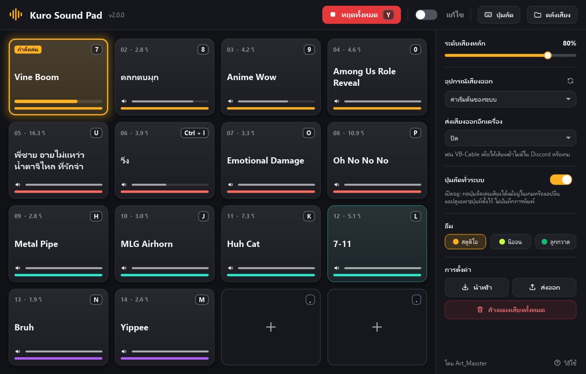
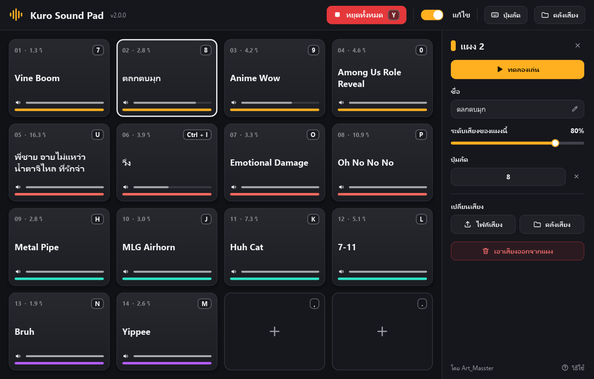
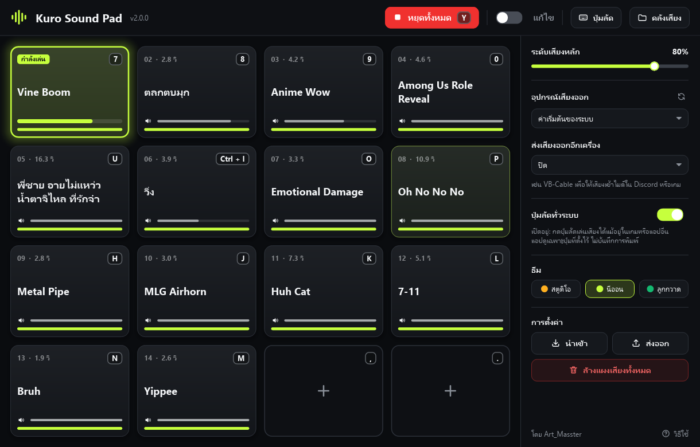
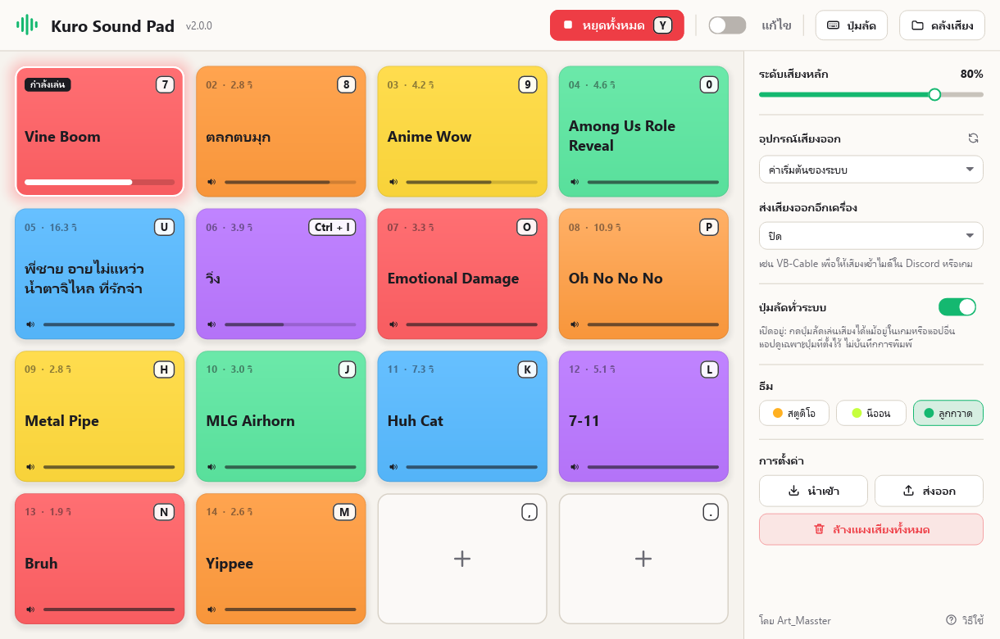

# Kuro Sound Pad

แผงเสียง 16 ปุ่มสำหรับสตรีมเมอร์และสายปาร์ตี้ กดที่แผงหรือกดปุ่มลัดบนคีย์บอร์ดแล้วเสียงออกทันที แม้กำลังอยู่ในเกมหรือแอปอื่น
เขียนด้วย Rust ทั้งตัว เป็นไฟล์ exe ไฟล์เดียวกับโฟลเดอร์คลังเสียง



## ทำอะไรได้บ้าง

- **16 แผงเสียง** ใส่ไฟล์ MP3, WAV, OGG, M4A, AAC, FLAC (ไม่เกิน 50MB) หรือลากไฟล์มาวางบนหน้าต่าง
- **คลังเสียง 288 เสียง** มีมาให้ในตัว ค้นหาและกดฟังก่อนเลือกได้
- **ปุ่มลัดทั่วระบบ** ใช้ร่วมกับ Ctrl, Shift, Alt ได้ ไม่ขึ้นกับภาษาแป้นพิมพ์ มีปุ่มหยุดเสียงทั้งหมด (เริ่มต้นคือ Y)
- **ระดับเสียงหลัก** และระดับเสียงแยกรายแผง
- **เลือกอุปกรณ์เสียงออก** และส่งเสียงออกอีกเครื่องพร้อมกันได้ เช่น VB-Cable เพื่อให้เสียงเข้าไมค์ใน Discord
- **นำเข้าและส่งออกการตั้งค่า** เป็นไฟล์ JSON ไฟล์เดียว (เสียงที่เพิ่มเองติดไปในไฟล์ด้วย) อ่านไฟล์ที่ส่งออกจาก Sound Pad Studio รุ่นเว็บ/Electron ได้
- **3 ธีม** สตูดิโอ นีออน ลูกกวาด
- แถบความคืบหน้าบนแผงที่กำลังเล่น กดซ้ำเพื่อเริ่มใหม่ เล่นหลายแผงซ้อนกันได้

| แก้ไขแผง | คลังเสียง |
|---|---|
|  |  |

| นีออน | ลูกกวาด |
|---|---|
|  |  |

## วิธีใช้

1. เปิดสวิตช์ **แก้ไข** แล้วกดเลือกแผง (หรือกดที่แผงว่างได้เลย) แถบด้านขวาจะเป็นตัวตั้งค่าของแผงนั้น
2. ใส่เสียงจากไฟล์ในเครื่องหรือจากคลังเสียง ตั้งชื่อ ระดับเสียง และปุ่มลัด
3. ปิดสวิตช์แก้ไข แล้วกดที่แผงหรือกดปุ่มลัดเพื่อเล่น

ปุ่มลัดเริ่มต้นเรียงตามแป้นพิมพ์: `7 8 9 0` / `U I O P` / `H J K L` / `N M , .`

## ปุ่มลัดทั่วระบบกับความเป็นส่วนตัว

ครั้งแรกที่เปิด แอปจะถามว่าให้ปุ่มลัดทำงานนอกแอปด้วยไหม ถ้าอนุญาต แอปจะติดตั้งตัวดักแป้นพิมพ์ของ Windows
(low-level keyboard hook) เพื่อเทียบปุ่มที่กดกับปุ่มลัดที่ตั้งไว้เท่านั้น ไม่บันทึก ไม่เก็บ และไม่ส่งการกดปุ่มไปที่ไหน
ปุ่มที่กดจะถูกส่งต่อให้แอปอื่นตามปกติ ถ้าไม่อนุญาต ตัวดักจะทำงานเฉพาะตอนหน้าต่างของแอปอยู่ด้านหน้า
เปลี่ยนได้ทุกเมื่อที่สวิตช์ **ปุ่มลัดทั่วระบบ** ในแถบด้านขวา

## ข้อมูลเก็บที่ไหน

- การตั้งค่า: `%APPDATA%\Kuro Sound Pad\settings.json`
- เสียงที่เพิ่มเอง (คัดลอกมาเก็บ ไฟล์ต้นทางย้ายหรือลบได้): `%APPDATA%\Kuro Sound Pad\sounds\`
- คลังเสียงที่มากับแอป: โฟลเดอร์ `library` ข้างไฟล์ exe

## พัฒนา

ต้องมี Rust (stable) บน Windows

```bash
cargo run
```

```bash
cargo test
```

ตัวช่วยตอนพัฒนา (ตัวแปรสภาพแวดล้อม):

| ตัวแปร | ผล |
|---|---|
| `KURO_DATA_DIR` | ใช้โฟลเดอร์นี้แทน `%APPDATA%\Kuro Sound Pad` |
| `KURO_LIBRARY_DIR` | ใช้โฟลเดอร์คลังเสียงนี้ |
| `KURO_LOG=1` | พิมพ์เหตุการณ์ของระบบเสียงออก stderr |
| `KURO_AUTOPLAY=0,1,stop,2` | เล่นแผงตามลำดับเองหลังเปิดแอป |
| `KURO_SHOT=<ไฟล์.png>` | ถ่ายภาพหน้าต่างแล้วปิด (`KURO_SHOT_STATE`, `KURO_SHOT_THEME` เลือกหน้าและธีม) |

`scripts\shots.ps1` ถ่ายภาพทุกหน้าลง `target\shots`, `scripts\live-test.ps1` เล่นเสียงจริงแล้วพิมพ์ผล

### โครงสร้างโค้ด

| ไฟล์ | หน้าที่ |
|---|---|
| `src/audio.rs` | เธรดเสียง: เปิดอุปกรณ์ เล่น หยุด ปรับระดับเสียง |
| `src/hotkey.rs` | ตัวดักแป้นพิมพ์ ส่งคำสั่งเล่นตรงไปที่เธรดเสียง |
| `src/keys.rs` | ปุ่มลัด ชื่อปุ่ม และรูปแบบเก่าของรุ่นเว็บ |
| `src/settings.rs` | การตั้งค่าและไฟล์เสียงที่ผู้ใช้เพิ่ม |
| `src/transfer.rs` | นำเข้าและส่งออก |
| `src/library.rs` | รายการคลังเสียง (`assets/library/index.json`) |
| `src/ui/` | หน้าต่าง (iced): สถานะ หน้าจอ ธีม ไอคอน |

## ออกรุ่น (Windows, ลงนามดิจิทัล)

```bash
pwsh scripts\release-windows.ps1
```

build แล้วส่งไปลงนามด้วยใบรับรองของ Pawat Benjaoun บนเครื่อง Siam จากนั้นได้ตัวติดตั้งและไฟล์ zip แบบพกพาใน `dist\`

## ที่มา

เขียนใหม่จาก Sound Pad Studio รุ่น React + Electron (เก็บไว้ที่ branch `project-web` ของ `MCDD-app/sound-scape-composer`)
