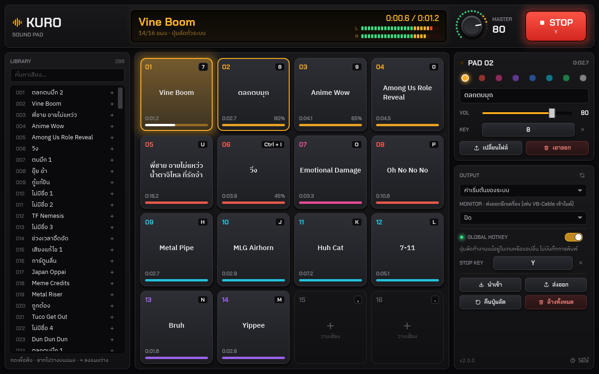
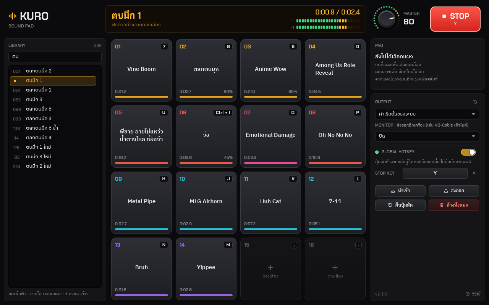

# Kuro Sound Pad

แผงเสียง 16 ปุ่มหน้าตาแบบเครื่อง DJ สำหรับสตรีมเมอร์และสายปาร์ตี้ กดที่แผงหรือกดปุ่มลัดบนคีย์บอร์ดแล้วเสียงออกทันที
แม้กำลังอยู่ในเกมหรือแอปอื่น ทุกอย่างอยู่ในหน้าเดียว เขียนด้วย Rust ทั้งตัว



## ทำอะไรได้บ้าง

- **16 แผงเสียง** ใส่ไฟล์ MP3, WAV, OGG, M4A, AAC, FLAC (ไม่เกิน 50MB) แต่ละแผงมีชื่อ สีไฟ ระดับเสียง และปุ่มลัดของตัวเอง
- **คลังเสียง 288 เสียง** อยู่ด้านซ้ายตลอด ค้นหาได้ กดเพื่อฟัง
- **ลากวางได้ทุกจุด**
  - ลากเสียงจากคลังไปวางบนแผง
  - ลากไฟล์เสียงจากเครื่องมาวางบนแผงที่ต้องการ (หลายไฟล์พร้อมกันได้ จะไล่ลงแผงว่างถัดไป)
  - ลากแผงไปวางบนอีกแผงเพื่อสลับที่
  - ลากไฟล์การตั้งค่า `.json` มาวางเพื่อนำเข้า
- **ปุ่มลัดทั่วระบบ** ใช้ร่วมกับ Ctrl, Shift, Alt ได้ ไม่ขึ้นกับภาษาแป้นพิมพ์ มีปุ่มหยุดเสียงทั้งหมด (เริ่มต้นคือ Y)
- **จอแสดงผล** บอกเสียงที่กำลังเล่น เวลา และมิเตอร์ระดับเสียงจริงซ้ายขวา
- **ลูกบิด Master** หมุนด้วยการลากขึ้นลงหรือล้อเมาส์ และเฟดเดอร์ระดับเสียงรายแผง
- **เลือกอุปกรณ์เสียงออก** และส่งเสียงออกอีกเครื่องพร้อมกันได้ เช่น VB-Cable เพื่อให้เสียงเข้าไมค์ใน Discord
- **นำเข้าและส่งออกการตั้งค่า** เป็นไฟล์ JSON ไฟล์เดียว (เสียงที่เพิ่มเองติดไปในไฟล์ด้วย) อ่านไฟล์ที่ส่งออกจาก Sound Pad Studio รุ่นเว็บ/Electron ได้
- **อัปเดตในแอป** เมื่อมีรุ่นใหม่ แอปจะแจ้งที่มุมขวาล่าง กดอัปเดตแล้วแอปดาวน์โหลด ติดตั้ง และเปิดใหม่เอง

## ติดตั้ง

ดาวน์โหลด `KuroSoundPad-<รุ่น>-win-x64-setup.exe` จากหน้า Releases แล้วเปิด กด **ติดตั้ง** ครั้งเดียวจบ
ติดตั้งให้ผู้ใช้คนเดียว (`%LOCALAPPDATA%\Programs\Kuro Sound Pad`) ไม่ต้องใช้สิทธิ์ผู้ดูแลระบบ
ตัวติดตั้ง ตัวแอป และตัวถอนการติดตั้งลงนามดิจิทัลในชื่อ Pawat Benjaoun ทั้งหมด

### การอัปเดต

แอปที่ติดตั้งแล้วจะดูรุ่นล่าสุดหลังเปิด 5 วินาที และทุกชั่วโมง (กดที่เลขรุ่นมุมขวาล่างเพื่อดูเดี๋ยวนั้นได้)
ไม่มีอะไรถูกดาวน์โหลดจนกว่าจะกด **อัปเดต** ก่อนรันตัวติดตั้งที่ดาวน์โหลดมา แอปจะตรวจสามอย่าง: ขนาดไฟล์ ค่า SHA-512
ตามที่ประกาศไว้ และลายเซ็นดิจิทัลต้องเป็นของผู้เผยแพร่รายเดียวกับตัวแอปเอง กด **ข้ามรุ่นนี้** ถ้าไม่ต้องการรุ่นนั้น

| ลากแผงเพื่อสลับที่ | ค้นหาและฟังจากคลังเสียง |
|---|---|
|  |  |

## วิธีใช้

1. ลากเสียงจากคลังด้านซ้าย หรือลากไฟล์จากเครื่อง มาวางบนแผง (กดที่แผงว่างเพื่อเลือกไฟล์ก็ได้)
2. กดที่แผงหรือกดปุ่มลัดเพื่อเล่น กดซ้ำเพื่อเริ่มใหม่ ปุ่ม STOP หยุดทุกเสียง
3. แผงที่กดล่าสุดจะขึ้นที่มุมขวาบน เปลี่ยนชื่อ สีไฟ ระดับเสียง และปุ่มลัดได้ตรงนั้น คลิกขวาที่แผงเพื่อเลือกโดยไม่เล่น

ปุ่มลัดเริ่มต้นเรียงตามแป้นพิมพ์: `7 8 9 0` / `U I O P` / `H J K L` / `N M , .`
ปุ่มลัดจะพักเองระหว่างที่พิมพ์ในช่องค้นหาหรือช่องชื่อ

## ปุ่มลัดทั่วระบบกับความเป็นส่วนตัว

ครั้งแรกที่เปิด แอปจะถามว่าให้ปุ่มลัดทำงานนอกแอปด้วยไหม ถ้าอนุญาต แอปจะติดตั้งตัวดักแป้นพิมพ์ของ Windows
(low-level keyboard hook) เพื่อเทียบปุ่มที่กดกับปุ่มลัดที่ตั้งไว้เท่านั้น ไม่บันทึก ไม่เก็บ และไม่ส่งการกดปุ่มไปที่ไหน
ปุ่มที่กดจะถูกส่งต่อให้แอปอื่นตามปกติ ถ้าไม่อนุญาต ตัวดักจะทำงานเฉพาะตอนหน้าต่างของแอปอยู่ด้านหน้า
เปลี่ยนได้ทุกเมื่อที่สวิตช์ **ปุ่มลัดทั่วระบบ** ในแถบด้านขวา

## ข้อมูลเก็บที่ไหน

- การตั้งค่า: `%APPDATA%\Kuro Sound Pad\settings.json`
- เสียงที่เพิ่มเอง (คัดลอกมาเก็บ ไฟล์ต้นทางย้ายหรือลบได้): `%APPDATA%\Kuro Sound Pad\sounds\`
- คลังเสียงที่มากับแอป: ไฟล์ `library.kpk` ข้างไฟล์ exe (รวมทุกเสียงและเข้ารหัสไว้ มีแต่แอปที่เปิดได้)

## พัฒนา

ต้องมี Rust (stable) บน Windows และไฟล์ `library.key` (รหัสของคลังเสียง ดูหัวข้อคลังเสียงด้านล่าง) วางข้าง `Cargo.toml`
build ที่ไม่มีรหัสยังทำงานได้ทุกอย่าง แต่คลังเสียงจะว่าง และเทสต์ที่ต้องใช้คลังเสียงจะข้ามไป

```bash
cargo run
```

```bash
cargo test
```

ตัวช่วยตอนพัฒนา (ตัวแปรสภาพแวดล้อม):

| ตัวแปร | ผล |
|---|---|
| `KURO_DATA_DIR` | ใช้โฟลเดอร์นี้แทน `%APPDATA%\Kuro Sound Pad` |
| `KURO_LIBRARY_PACK` | ใช้ไฟล์คลังเสียงนี้แทน `library.kpk` |
| `KURO_LOG=1` | พิมพ์เหตุการณ์ของระบบเสียงและค่ามิเตอร์ออก stderr |
| `KURO_AUTOPLAY=0,1,h5,stop` | ทำตามลำดับเองหลังเปิดแอป: ตัวเลขคือเล่นแผงนั้น, `h5` คือจำลองเมาส์ชี้แผง 5, `check` คือตรวจหารุ่นใหม่, `update` คือกดอัปเดต, `-` คือรอ, อย่างอื่นคือหยุดทั้งหมด |
| `KURO_SHOT=<ไฟล์.png>` | ถ่ายภาพหน้าต่างแล้วปิด (`KURO_SHOT_STATE` เลือกสถานะที่จะแสดง) |
| `KURO_UPDATE_FEED=http://127.0.0.1:8000` | อ่าน `latest.yml` และตัวติดตั้งจากที่นี่แทน GitHub (ใช้ทดสอบการอัปเดต) |

สคริปต์ช่วยตรวจ (ใช้ build แบบ debug กับข้อมูลใน `target\live-data`):

| สคริปต์ | ทำอะไร |
|---|---|
| `scripts\shots.ps1` | ถ่ายภาพทุกสถานะลง `target\shots` (วาดใหม่ทั้งหน้าต่าง ใช้ดูการจัดวาง) |
| `scripts\window-shot.ps1` | อ่านภาพจากหน้าต่างจริงหลังเล่นเสียงและขยับเมาส์จำลอง ใช้จับอาการที่เกิดจากการวาดซ้ำเฉพาะส่วน |
| `scripts\cpu.ps1` | วัด CPU ตอนอยู่เฉยๆ และตอนเล่นเสียง |
| `scripts\live-test.ps1` | เล่นเสียงจริงแล้วพิมพ์เหตุการณ์ของระบบเสียง |

### คลังเสียง

เสียงที่มากับแอปไม่ได้อยู่ใน repo เป็นไฟล์เสียงธรรมดา แต่อยู่ใน `assets/library.kpk` ไฟล์เดียว: แต่ละเสียงถูกบีบอัดแล้วเข้ารหัส
(XChaCha20-Poly1305) เสียงที่เนื้อหาซ้ำกันเก็บครั้งเดียว แอปอ่านทีละเสียงเข้าหน่วยความจำตอนจะเล่น จึงไม่มีไฟล์เสียงวางอยู่ให้คัดลอก
ทั้งใน repo และในเครื่องผู้ใช้

รหัสเป็นเลขฐานสิบหก 64 หลักในไฟล์ `library.key` ซึ่ง **ไม่อยู่ใน git** ตอน build รหัสจะถูกฝังลงในตัวแอป
(กันการคัดลอกไฟล์ออกไปใช้ได้ แต่กันคนที่ตั้งใจแกะตัวโปรแกรมไม่ได้) เก็บสำเนา `library.key` ไว้ให้ดี ถ้าหาย คลังเสียงใน repo จะเปิดไม่ได้อีก

แก้ไขคลังเสียง:

```bash
cargo run --example library -- unpack
```

ได้โฟลเดอร์ `library-src` (git ไม่เก็บ) มีไฟล์เสียง `001.mp3` … และ `index.json` เพิ่มหรือแทนที่ไฟล์เสียง แก้ `index.json`
(`id`, `file`, `name` และ `was` คือชื่อไฟล์ที่เสียงนั้นเคยใช้ในรุ่นก่อน แผงเสียงที่บันทึกไว้ด้วยชื่อเก่าจะยังหาเจอ) แล้วรวมกลับ:

```bash
cargo run --example library -- pack
```

จากนั้น commit `assets/library.kpk` การรวมเสียงชุดเดิมซ้ำได้ไฟล์เดิมทุกไบต์ git จึงเห็นการเปลี่ยนแปลงเฉพาะเมื่อคลังเสียงเปลี่ยนจริง

### ข้อควรรู้เรื่องการวาด

แอปใช้ตัววาดแบบซอฟต์แวร์ (tiny-skia) ซึ่งวาดใหม่เฉพาะส่วนที่เปลี่ยน มีกฎสองข้อใน `src/ui/style.rs`:

- **ห้ามใช้เงา (shadow)** เงาถูกวาดทับทั้งชิ้นทุกครั้งที่มีส่วนเล็กๆ ในชิ้นนั้นเปลี่ยน จึงซ้อนกันจนดำหรือจ้า
- **ของที่ขยับต้องไม่วางบนแผ่นพื้นใหญ่** ทุกชิ้นที่อยู่ใต้จุดที่เปลี่ยนจะถูกระบายใหม่ทั้งชิ้น แผงเสียงและจอจึงวางบนพื้นหลังของหน้าต่างโดยตรง

### โครงสร้างโค้ด

| ไฟล์ | หน้าที่ |
|---|---|
| `src/audio.rs` | เธรดเสียง: เปิดอุปกรณ์ เล่น หยุด ปรับระดับเสียง วัดระดับเสียงให้มิเตอร์ |
| `src/hotkey.rs` | ตัวดักแป้นพิมพ์ ส่งคำสั่งเล่นตรงไปที่เธรดเสียง |
| `src/keys.rs` | ปุ่มลัด ชื่อปุ่ม และรูปแบบเก่าของรุ่นเว็บ |
| `src/settings.rs` | การตั้งค่าและไฟล์เสียงที่ผู้ใช้เพิ่ม |
| `src/transfer.rs` | นำเข้าและส่งออก |
| `src/library.rs`, `src/pack.rs` | คลังเสียงที่มากับแอป และรูปแบบไฟล์ `library.kpk` |
| `src/updater.rs` | ตรวจหารุ่นใหม่ ดาวน์โหลด ตรวจไฟล์ แล้วส่งต่อให้ตัวติดตั้ง |
| `src/http.rs`, `src/trust.rs` | การดาวน์โหลด และการอ่านว่าใครลงนามไฟล์ (Authenticode) |
| `installer/installer.nsi` | ตัวติดตั้ง (NSIS) ภาพประกอบวาดโดย `scripts/installer-art.py` |
| `src/ui/` | หน้าต่าง (iced): สถานะและการลากวาง (`mod.rs`) หน้าจอ (`view.rs`) หน้าตา (`style.rs`) ลูกบิด ไอคอน |
| `assets/fonts/` | IBM Plex Sans Thai และ Chakra Petch (OFL) ฝังอยู่ในไฟล์โปรแกรม |

## ออกรุ่น (Windows, ลงนามดิจิทัล)

```bash
pwsh scripts\release-windows.ps1
```

build แล้วส่งไปลงนามด้วยใบรับรองของ Pawat Benjaoun บนเครื่อง Siam ได้ตัวติดตั้งกับ `latest.yml` (ไฟล์ที่แอปใช้ดูว่ามีรุ่นใหม่) ใน `dist\`
เติม `-Upload` เพื่ออัปโหลดขึ้น GitHub Release ของรุ่นนั้น (เป็นฉบับร่าง) หรือ `-Publish` เพื่อเผยแพร่เป็นรุ่นล่าสุด
แอปที่ติดตั้งไปแล้วจะเห็นรุ่นใหม่ก็ต่อเมื่อเผยแพร่แล้วเท่านั้น

สิ่งที่ถูกลงนาม (รายละเอียดใน `scripts/siam-package.sh`):

| ไฟล์ | ลงนามตอนไหน |
|---|---|
| ตัวแอป `Kuro Sound Pad.exe` | ก่อนใส่ลงตัวติดตั้ง |
| ตัวถอนการติดตั้ง | ตอนที่ makensis สร้างมันขึ้น |
| ปลั๊กอินของ NSIS ที่ตัวติดตั้งแตกออกมาใช้ระหว่างทำงาน | ครั้งเดียว แล้วเก็บไว้ใช้ซ้ำบนเครื่อง Siam |
| ตัวติดตั้ง | สุดท้าย หลังรวมทุกอย่างข้างบนแล้ว |

## ที่มา

เขียนใหม่จาก Sound Pad Studio รุ่น React + Electron (เก็บไว้ที่ branch `project-web` ของ `MCDD-app/sound-scape-composer`)
