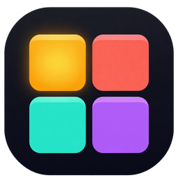
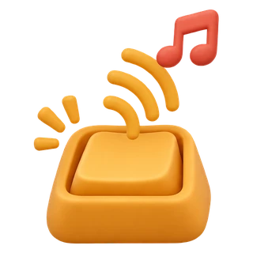
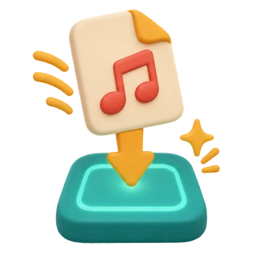
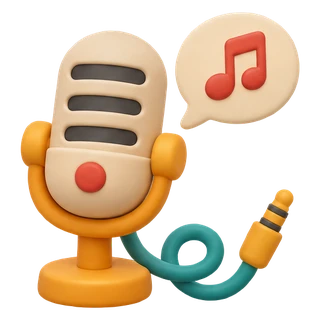
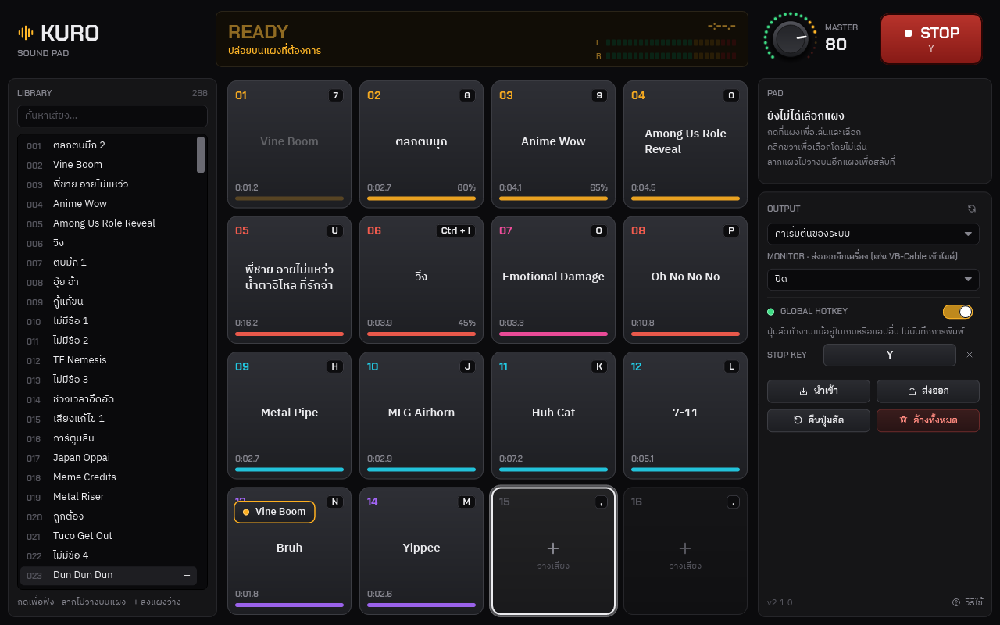
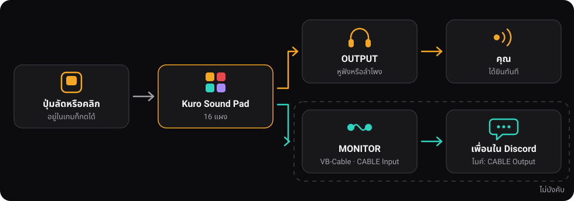

<h1 align="center">
  <br>
  Kuro Sound Pad
</h1>

<p align="center">
  แผงเสียง 16 ปุ่มหน้าตาแบบเครื่อง DJ กดที่แผงหรือกดปุ่มลัด เสียงออกทันที แม้กำลังอยู่ในเกม
</p>

<p align="center">
  <a href="https://github.com/artmasster/kuro-sound-pad/releases/latest"></a>
</p>

<p align="center">
  
  
  <a href="https://github.com/artmasster/kuro-sound-pad/releases"></a>
</p>

<p align="center">
  <b>ไทย</b> · <a href="docs/README.en.md">English</a>
</p>

<p align="center">
  
</p>

Kuro Sound Pad คือแผงเสียงสำหรับสตรีมเมอร์และคนที่ชอบแกล้งเพื่อนในห้องคุย ใส่เสียงลงแผง ตั้งปุ่มลัด แล้วกดได้จากทุกที่
มีคลังเสียง 288 เสียงมาในตัว เปิดครั้งแรกก็มีเสียงพร้อมกดครบ 16 แผง

<table>
  <tr>
    <td align="center" width="33%">
      <br>
      <b>กดจากในเกมได้</b><br>
      ปุ่มลัดทำงานทั่วระบบ ไม่ต้องสลับหน้าต่างมาที่แอป
    </td>
    <td align="center" width="33%">
      <br>
      <b>ลากวางได้ทุกจุด</b><br>
      เสียงจากคลัง ไฟล์จากเครื่อง หรือลากแผงไปสลับที่กัน
    </td>
    <td align="center" width="33%">
      <br>
      <b>เพื่อนได้ยินด้วย</b><br>
      ส่งเสียงออกอีกเครื่องพร้อมกัน เช่น VB-Cable เข้าไมค์ใน Discord
    </td>
  </tr>
</table>

<p align="center">
  
</p>

## ดาวน์โหลด

**[ดาวน์โหลดตัวติดตั้งรุ่นล่าสุดจากหน้า Releases](https://github.com/artmasster/kuro-sound-pad/releases/latest)** ไฟล์ `KuroSoundPad-x.y.z-win-x64-setup.exe`

เปิดไฟล์แล้วกด **ติดตั้ง** ครั้งเดียวจบ ใช้กับ Windows 10 / 11 ไม่ต้องใช้สิทธิ์ผู้ดูแลระบบ
ตัวติดตั้ง ตัวแอป และตัวถอนการติดตั้งลงนามดิจิทัลในชื่อ Pawat Benjaoun

## เริ่มใช้

1. ลากเสียงจากคลังด้านซ้าย หรือลากไฟล์เสียงจากเครื่อง มาวางบนแผง (กดที่แผงว่างเพื่อเลือกไฟล์ก็ได้)
2. กดที่แผงหรือกดปุ่มลัดเพื่อเล่น กดซ้ำเพื่อเริ่มใหม่ ปุ่ม **STOP** หยุดทุกเสียง
3. แผงที่กดล่าสุดจะขึ้นที่มุมขวาบน เปลี่ยนชื่อ สีไฟ ระดับเสียง และปุ่มลัดได้ตรงนั้น

ปุ่มลัดเริ่มต้นเรียงตามแป้นพิมพ์: `7 8 9 0` / `U I O P` / `H J K L` / `N M , .` และ `Y` หยุดทุกเสียง

## ทำอะไรได้บ้าง

- 🎛️ **16 แผงเสียง** แต่ละแผงมีชื่อ สีไฟ ระดับเสียง และปุ่มลัดของตัวเอง
- 🎵 **คลังเสียง 288 เสียง** มากับแอป ค้นหาได้ กดเพื่อฟังก่อน
- 📂 **ใส่เสียงของตัวเองได้** MP3, WAV, OGG, M4A, AAC, FLAC (ไม่เกิน 50MB ต่อไฟล์)
- ⌨️ **ปุ่มลัดทั่วระบบ** ใช้ร่วมกับ Ctrl, Shift, Alt ได้ ไม่ขึ้นกับภาษาแป้นพิมพ์ · มีปุ่มหยุดทุกเสียง
- 📟 **จอแสดงผล** บอกเสียงที่กำลังเล่น เวลา และมิเตอร์ระดับเสียงจริงซ้ายขวา
- 💾 **นำเข้าและส่งออกการตั้งค่า** เป็นไฟล์เดียว เสียงที่เพิ่มเองติดไปด้วย · อ่านไฟล์จาก Sound Pad Studio รุ่นเก่าได้
- ⬆️ **อัปเดตในแอป** มีรุ่นใหม่แอปจะแจ้งที่มุมขวาล่าง กดครั้งเดียวแล้วดาวน์โหลด ติดตั้ง และเปิดใหม่เอง
- 🪶 **เบาเครื่อง** เขียนด้วย Rust ทั้งตัว ไม่ใช้ CPU ตอนอยู่เฉยๆ และใช้ราว 2% ของหนึ่งคอร์ตอนเล่นเสียง

## วิธีใช้

| ทำอะไร | ผล |
|---|---|
| **คลิกที่แผง** หรือกดปุ่มลัด | เล่นเสียง (กดซ้ำ = เริ่มใหม่) |
| **คลิกขวา** ที่แผง | เลือกแผงโดยไม่เล่น |
| **คลิกที่เสียงในคลัง** | ฟังก่อน |
| **ลากเสียงจากคลัง** ไปวางบนแผง | ใส่เสียงนั้นลงแผง |
| **ลากไฟล์เสียงจากเครื่อง** มาวางบนแผง | ใส่ลงแผงนั้น หลายไฟล์พร้อมกันจะไล่ลงแผงว่างถัดไป |
| **ลากแผง** ไปวางบนอีกแผง | สลับที่กัน |
| **ลากไฟล์การตั้งค่า** `.json` มาวาง | นำเข้า |
| **ลูกบิด Master** ลากขึ้นลงหรือหมุนล้อเมาส์ | ปรับระดับเสียงรวม |
| **ล้างทั้งหมด** | เลือกได้ว่าจะกลับไปใช้ชุดเสียงเริ่มต้น หรือลบเสียงออกจากทุกแผง |
| **คลิกที่เลขรุ่น** มุมขวาล่าง | ดูว่ามีรุ่นใหม่ไหมเดี๋ยวนั้น |

ปุ่มลัดจะพักเองระหว่างที่พิมพ์ในช่องค้นหาหรือช่องชื่อ

<table>
  <tr>
    <td align="center"><b>ลากแผงเพื่อสลับที่</b><br></td>
    <td align="center"><b>ค้นหาและฟังจากคลังเสียง</b><br></td>
  </tr>
  <tr>
    <td align="center" colspan="2"><b>มีรุ่นใหม่</b><br></td>
  </tr>
</table>

## ให้เพื่อนใน Discord ได้ยิน

<p align="center">
  
</p>

เสียงออกได้สองทางพร้อมกัน ช่อง **OUTPUT** คือหูฟังหรือลำโพงที่คุณฟังเอง ส่วนช่อง **MONITOR** ไม่บังคับ ใช้ตอนอยากให้คนอื่นได้ยินด้วย

1. ติดตั้ง [VB-Cable](https://vb-audio.com/Cable/)
2. ในแอป ช่อง **MONITOR** เลือก `CABLE Input`
3. ใน Discord เลือกไมค์เป็น `CABLE Output`

## ปุ่มลัดทั่วระบบกับความเป็นส่วนตัว

ครั้งแรกที่เปิด แอปจะถามว่าให้ปุ่มลัดทำงานนอกแอปด้วยไหม ถ้าอนุญาต แอปจะเทียบปุ่มที่กดกับปุ่มลัดที่ตั้งไว้เท่านั้น
**ไม่บันทึก ไม่เก็บ และไม่ส่งการกดปุ่มไปที่ไหน** ปุ่มที่กดยังไปถึงแอปอื่นตามปกติ
ถ้าไม่อนุญาต ปุ่มลัดจะทำงานเฉพาะตอนหน้าต่างของแอปอยู่ด้านหน้า เปลี่ยนได้ทุกเมื่อที่สวิตช์ **ปุ่มลัดทั่วระบบ** ในแถบด้านขวา

> [!NOTE]
> แอปต่ออินเทอร์เน็ตเพื่อดูว่ามีรุ่นใหม่บน GitHub เท่านั้น และไม่ดาวน์โหลดอะไรจนกว่าจะกด **อัปเดต**
> ก่อนติดตั้ง แอปจะตรวจว่าไฟล์ที่ได้มาลงนามโดยผู้เผยแพร่รายเดียวกับตัวแอปเอง กด **ข้ามรุ่นนี้** ถ้าไม่ต้องการรุ่นนั้น

## แก้ปัญหา

| อาการ | ทำไง |
|---|---|
| ปุ่มลัดไม่ทำงานตอนอยู่ในเกม | เปิดสวิตช์ **ปุ่มลัดทั่วระบบ** · ถ้าเกมเปิดแบบ Run as administrator ให้เปิด Kuro Sound Pad แบบเดียวกัน |
| เสียงดังตอนพิมพ์แชต | ตั้งปุ่มลัดให้ใช้ร่วมกับ Ctrl / Alt หรือปิดสวิตช์ **ปุ่มลัดทั่วระบบ** ชั่วคราว |
| เพื่อนใน Discord ไม่ได้ยิน | ทำตามหัวข้อ [ให้เพื่อนใน Discord ได้ยิน](#ให้เพื่อนใน-discord-ได้ยิน) |
| เสียบหูฟังใหม่แล้วไม่ขึ้นในรายการ | กดปุ่มรีเฟรชข้างหัวข้อ **OUTPUT** |
| ใส่ไฟล์ไม่ได้ | ไฟล์ต้องเป็น MP3, WAV, OGG, M4A, AAC, FLAC และไม่เกิน 50MB |
| ปุ่มลัดมั่วไปหมด | กด **คืนปุ่มลัด** เพื่อกลับไปใช้ชุดเริ่มต้น |

ถอนการติดตั้ง: **Settings → Apps** · การตั้งค่าและเสียงที่เพิ่มเองอยู่ที่ `%APPDATA%\Kuro Sound Pad`

## มีอะไรใหม่

**2.1.2**
- **ชุดเสียงเริ่มต้น** ติดตั้งใหม่แล้วมีเสียงพร้อมกดครบ 16 แผง
- **ล้างทั้งหมด** เลือกได้ว่าจะกลับไปใช้ชุดเริ่มต้น หรือลบเสียงออกจากทุกแผง

**2.1.1**
- **ตัวติดตั้งใหม่** และ **อัปเดตในแอป**
- คลังเสียงรวมเป็นไฟล์เดียว ใช้พื้นที่น้อยลง แผงเสียงที่ตั้งไว้ในรุ่นก่อนยังใช้ได้เหมือนเดิม
- แก้ชื่อบนแผงที่บางครั้งขาดด้านซ้ายหลังเปิดแอป แผงเสียงดำจนกว่าจะเอาเมาส์ไปชี้ และแสงของแผงที่กำลังเล่นซ้อนกันจนจ้า

**2.1.0** หน้าตาใหม่ทั้งหมด: แผงควบคุมสีดำ ทุกอย่างอยู่ในหน้าเดียว · ลากวางได้ทุกจุด

**2.0.0** เขียนใหม่ด้วย Rust จาก Sound Pad Studio

ทุกรุ่น: [Releases](https://github.com/artmasster/kuro-sound-pad/releases)

<details>
<summary><b>พัฒนา</b></summary>

ต้องมีแค่ [Rust](https://rustup.rs) บน Windows

```bash
git clone https://github.com/artmasster/kuro-sound-pad.git && cd kuro-sound-pad
cargo run
```

คลังเสียงที่มากับแอปเข้ารหัสไว้และรหัสไม่อยู่ใน repo build จากที่นี่จึงทำงานได้ทุกอย่าง แต่คลังเสียงจะว่าง (ใส่เสียงของตัวเองได้ตามปกติ)
รายละเอียดอื่นอยู่ใน [docs/development.md](docs/development.md)
</details>
