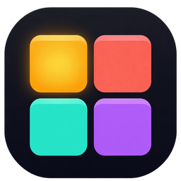
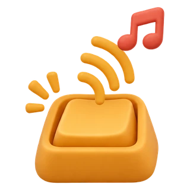
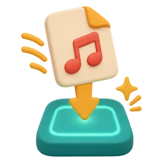
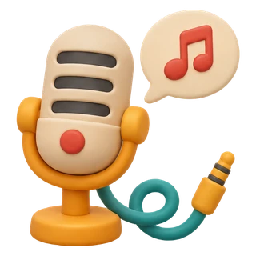
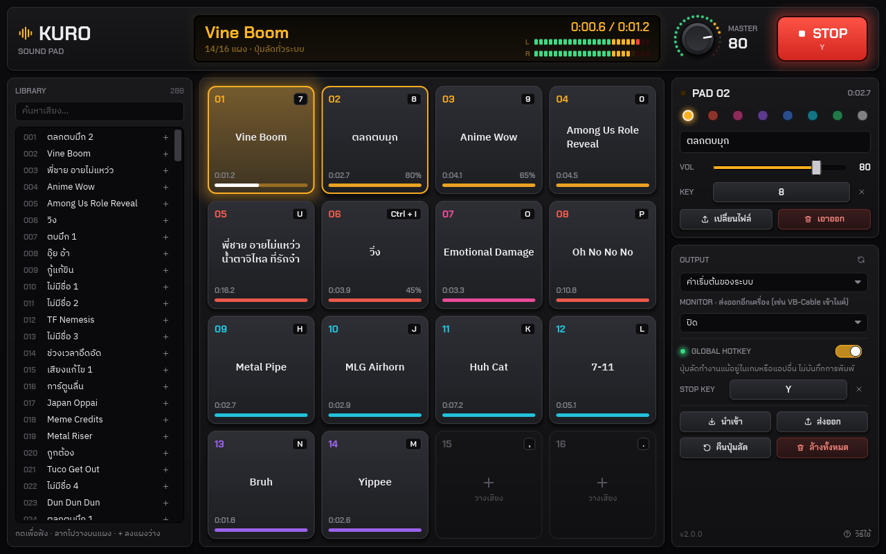
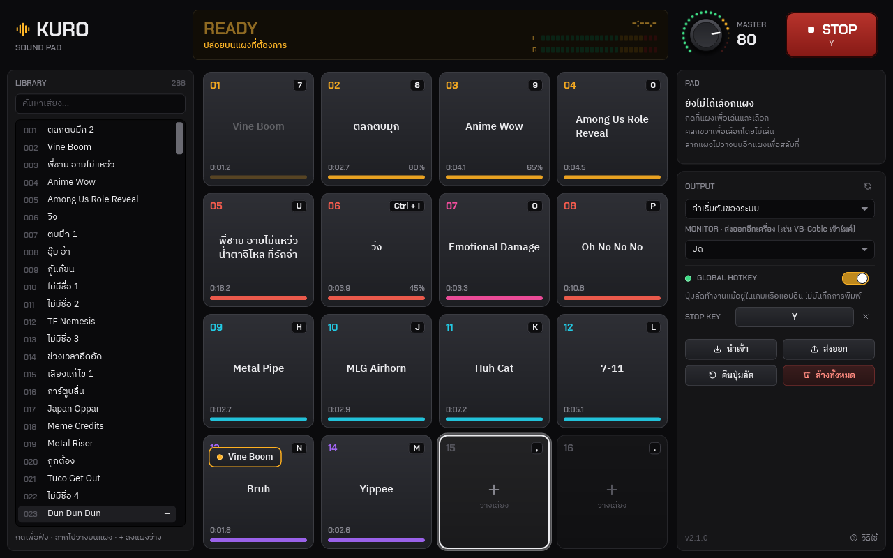
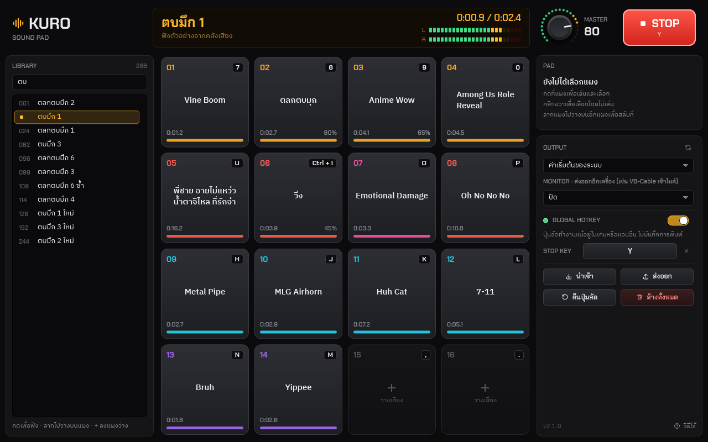
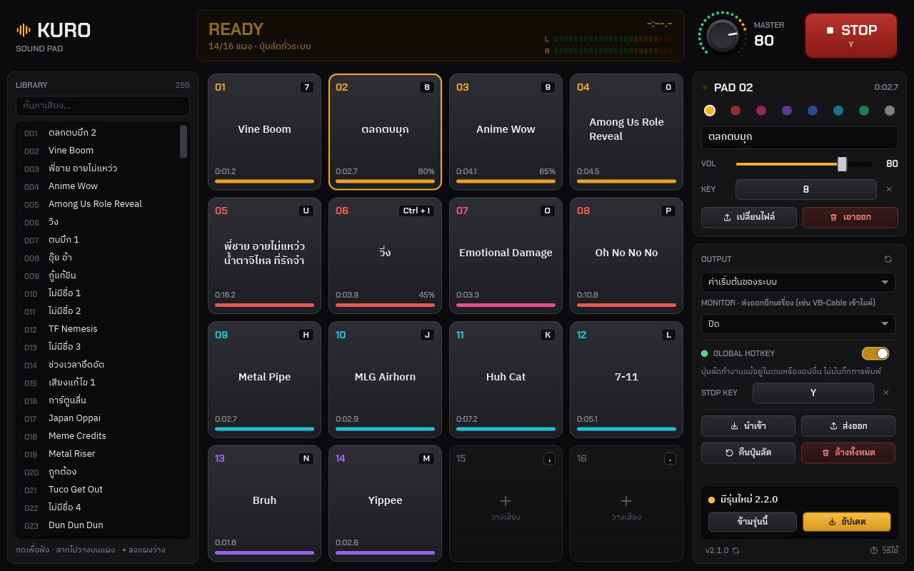
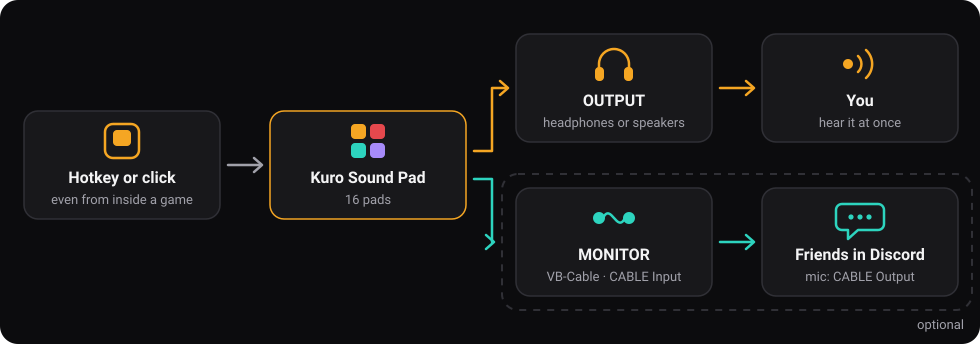

<h1 align="center">
  <br>
  Kuro Sound Pad
</h1>

<p align="center">
  A 16-pad soundboard that looks like a DJ controller. Press a pad or a hotkey and the sound plays at once, even from inside a game.
</p>

<p align="center">
  <a href="https://github.com/artmasster/kuro-sound-pad/releases/latest"></a>
</p>

<p align="center">
  
  
  <a href="https://github.com/artmasster/kuro-sound-pad/releases"></a>
</p>

<p align="center">
  <a href="../README.md">ไทย</a> · <b>English</b>
</p>

<p align="center">
  
</p>

Kuro Sound Pad is a soundboard for streamers and for anyone who likes to tease friends in voice chat. Put sounds on the pads,
give them hotkeys, and play them from anywhere. It comes with a library of 288 sounds, and all 16 pads are ready to press on first start.

> The app's interface and installer are in Thai for now. This page gives the Thai name of each button next to its meaning.

<table>
  <tr>
    <td align="center" width="33%">
      <br>
      <b>Works inside games</b><br>
      Hotkeys work system-wide, so you never have to switch back to the app.
    </td>
    <td align="center" width="33%">
      <br>
      <b>Drag and drop everywhere</b><br>
      Sounds from the library, files from your PC, or one pad onto another to swap them.
    </td>
    <td align="center" width="33%">
      <br>
      <b>Friends hear it too</b><br>
      Send the sound to a second device at the same time, such as VB-Cable as your Discord microphone.
    </td>
  </tr>
</table>

<p align="center">
  
</p>

## Download

**[Download the latest installer from the Releases page](https://github.com/artmasster/kuro-sound-pad/releases/latest)**, the file `KuroSoundPad-x.y.z-win-x64-setup.exe`

Open it and press **ติดตั้ง** (Install) once. It runs on Windows 10 / 11 and does not need administrator rights.
The installer, the app and the uninstaller are digitally signed by Pawat Benjaoun.

## Get started

1. Drag a sound from the library on the left, or an audio file from your PC, onto a pad. You can also click an empty pad to pick a file.
2. Click the pad or press its hotkey to play. Press again to restart it. **STOP** stops every sound.
3. The pad you pressed last appears at the top right, where you can change its name, light colour, volume and hotkey.

The default hotkeys follow the keyboard rows: `7 8 9 0` / `U I O P` / `H J K L` / `N M , .`, and `Y` stops every sound.

## What it can do

- 🎛️ **16 pads**, each with its own name, light colour, volume and hotkey
- 🎵 **A library of 288 sounds** comes with the app. Search it and click a sound to hear it first
- 📂 **Add your own sounds**: MP3, WAV, OGG, M4A, AAC, FLAC (up to 50MB per file)
- ⌨️ **System-wide hotkeys** that can be combined with Ctrl, Shift and Alt and do not depend on the keyboard language · a hotkey to stop every sound
- 📟 **A display** showing the sound that is playing, its time, and real left and right level meters
- 💾 **Import and export your setup** as one file that includes the sounds you added · reads files from the old Sound Pad Studio
- ⬆️ **Updates inside the app**: a new version is announced at the bottom right, and one click downloads it, installs it and reopens the app
- 🪶 **Light**: written entirely in Rust, uses no CPU when idle and about 2% of one core while playing

## How to use it

| Do this | Result |
|---|---|
| **Click a pad** or press its hotkey | Plays the sound (again = restart) |
| **Right-click** a pad | Selects the pad without playing it |
| **Click a sound in the library** | Hear it first |
| **Drag a sound from the library** onto a pad | Puts that sound on the pad |
| **Drag audio files from your PC** onto a pad | Puts them on that pad; several files fill the next empty pads |
| **Drag a pad** onto another pad | Swaps them |
| **Drop a settings file** `.json` on the window | Imports it |
| **Master knob**: drag up and down, or turn the mouse wheel | Changes the overall volume |
| **ล้างทั้งหมด** (Clear all) | Lets you go back to the starter set of sounds, or remove the sounds from every pad |
| **Click the version number** at the bottom right | Checks for a new version right away |

Hotkeys pause by themselves while you type in the search box or the name box.

<table>
  <tr>
    <td align="center"><b>Drag a pad to swap</b><br></td>
    <td align="center"><b>Search and listen in the library</b><br></td>
  </tr>
  <tr>
    <td align="center" colspan="2"><b>A new version is available</b><br></td>
  </tr>
</table>

## Let friends in Discord hear it

<p align="center">
  
</p>

The sound can go two ways at once. **OUTPUT** is the headphones or speakers you listen on. **MONITOR** is optional, for when others should hear it too.

1. Install [VB-Cable](https://vb-audio.com/Cable/)
2. In the app, set **MONITOR** to `CABLE Input`
3. In Discord, set the microphone to `CABLE Output`

## System-wide hotkeys and privacy

On first start the app asks whether hotkeys may work outside the app. If you allow it, the app only compares each key you press with the hotkeys you set.
**It does not record, store or send your key presses anywhere**, and the keys still reach other apps as usual.
If you do not allow it, hotkeys work only while the app's window is in front. You can change this at any time with the **ปุ่มลัดทั่วระบบ** (GLOBAL HOTKEY) switch in the right-hand bar.

> [!NOTE]
> The app goes online only to see whether GitHub has a new version, and downloads nothing until you press **อัปเดต** (Update).
> Before installing, it checks that the file it received is signed by the same publisher as the app itself. Press **ข้ามรุ่นนี้** (Skip this version) if you do not want that version.

## Troubleshooting

| Problem | What to do |
|---|---|
| Hotkeys do nothing inside a game | Turn on the **ปุ่มลัดทั่วระบบ** (GLOBAL HOTKEY) switch · if the game runs as administrator, start Kuro Sound Pad the same way |
| Sounds play while you type in chat | Set hotkeys that use Ctrl / Alt, or turn the **ปุ่มลัดทั่วระบบ** switch off for a while |
| Friends in Discord cannot hear it | Follow [Let friends in Discord hear it](#let-friends-in-discord-hear-it) |
| Newly plugged-in headphones are not in the list | Press the refresh button next to **OUTPUT** |
| A file cannot be added | It must be MP3, WAV, OGG, M4A, AAC or FLAC and no larger than 50MB |
| The hotkeys are a mess | Press **คืนปุ่มลัด** (Restore hotkeys) to go back to the default set |

Uninstall: **Settings → Apps** · your settings and the sounds you added are in `%APPDATA%\Kuro Sound Pad`

## What's new

**2.1.2**
- **A starter set of sounds**: a new install has all 16 pads ready to press
- **ล้างทั้งหมด** (Clear all) lets you go back to the starter set, or remove the sounds from every pad

**2.1.1**
- **A new installer** and **updates inside the app**
- The sound library is now one file and takes less space. Pads set up in earlier versions keep working
- Fixed pad names that sometimes lost their left side after start-up, pads that stayed black until the mouse pointed at them, and the glow of a playing pad piling up until it was too bright

**2.1.0** A completely new look: a black control surface with everything on one page · drag and drop everywhere

**2.0.0** Rewritten in Rust from Sound Pad Studio

Every version: [Releases](https://github.com/artmasster/kuro-sound-pad/releases)

<details>
<summary><b>Development</b></summary>

All you need is [Rust](https://rustup.rs) on Windows.

```bash
git clone https://github.com/artmasster/kuro-sound-pad.git && cd kuro-sound-pad
cargo run
```

The bundled sound library is encrypted and its key is not in the repository, so a build from here does everything, but the library is empty (you can still add your own sounds).
More details are in [docs/development.md](development.md) (in Thai).
</details>
